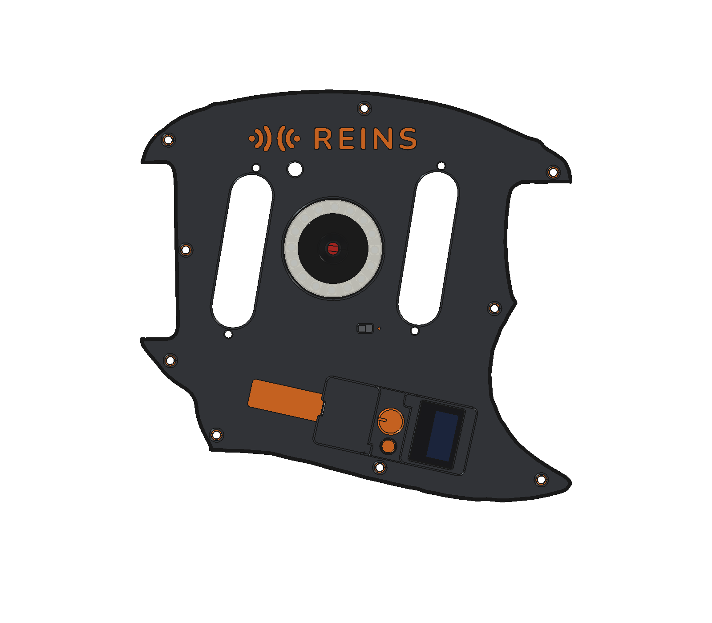
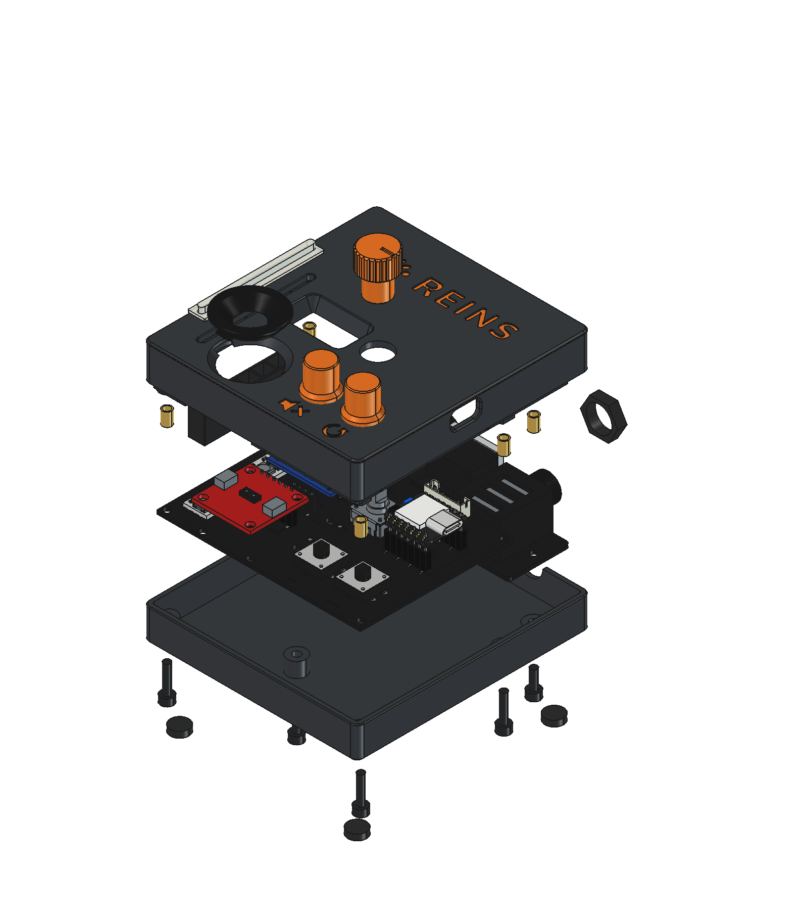

# REINS: gesture MIDI for guitar

REINS turns hand movement over a guitar into MIDI. A distance sensor in a printed pickguard measures how high your hand floats over the body. The guitar sends that as MIDI over radio to a small box on the floor. The box plays it out over USB MIDI and 5-pin DIN. The box also has its own sensor, an expression pedal input and two footswitch inputs.

Website with a 3D model and a live demo: **<https://alejo-end.github.io/reins/>**

| Guitar: the pickguard (version 2) | Floor: the receiver box (case version 2) |
| --- | --- |
|  |  |

## How it works

```
 GUITAR (transmitter)                          FLOOR BOX (receiver)
 XIAO ESP32-S3 Sense                           XIAO ESP32-S3 Plus
 VL53L1X ToF sensor, 16 LED ring,   ESP-NOW    VL53L5CX 8x8 ToF sensor, 8 LED stick,
 OLED, encoder, mute button, LiPo  ────────▶   OLED, encoder, MODE and MUTE buttons
                                   2 to 4 ms
 USB MIDI out                                  USB MIDI out, 5-pin DIN MIDI out
                                               EXP pedal in, FOOT in (MUTE, HOLD)
```

1. The guitar reads the hand distance every 20 ms. It sends two CCs on MIDI channel 1: CC 20 for the distance and CC 21 for the hand speed. By default, 10 mm gives 0 and 500 mm gives 127.
2. Every message goes out over USB MIDI and over ESP-NOW radio at the same time. ESP-NOW is connectionless WiFi from Espressif. The guitar broadcasts on WiFi channel 1. Each packet is 5 bytes: `0xCB`, a counter, then the 3 MIDI bytes. The box uses the counter to count lost packets.
3. The box forwards the guitar's MIDI to USB (class compliant) and to the DIN socket. Its own 8 x 8 zone sensor sends CC 22 and CC 23 on channel 2. An expression pedal on EXP sends CC 11 on channel 2.
4. FOOT takes two footswitches on one TRS cable. The tip is MUTE: it toggles mute and sends All Notes Off. The ring is HOLD: while it is down, the box's own CCs and the pedal stay frozen.
5. The MODE button chooses the source: both sensors, the guitar only or the box only. A long press on MODE pairs the box with the guitar it hears.

## What is in this repository

| Folder | Content |
| --- | --- |
| [`code/tof_midi_v5/`](code/tof_midi_v5/) | Guitar firmware (current) |
| [`code/tof_midi_v6_rx/`](code/tof_midi_v6_rx/) | Receiver firmware (current): radio to USB and DIN, local sensor, pedal, footswitches |
| [`code/tof_midi_v6/`](code/tof_midi_v6/) | Larger receiver firmware with a note router, presets and a WiFi page for its settings. Not tested on a board |
| `code/tof_midi_v4/`, `code/debug*/` | Older guitar firmware and test sketches |
| [`reins-guitar/`](reins-guitar/) | Guitar board for JLCPCB (KiCad), with Gerbers, BOM and CPL |
| [`reins-guitar/pickguard/`](reins-guitar/pickguard/) | Printed pickguard: FreeCAD scripts, STL files and sliced print files |
| [`reins-ring/`](reins-ring/) | 16 LED ring board for JLCPCB, made by a script |
| [`receiver-case/`](receiver-case/) | STL files of the receiver box case |
| [`order/`](order/) | JLCPCB order options, cable guide and DigiKey parts list |
| `finalMidiGuitar/`, `HARDWARE.md` | The first milled guitar board and its specification (older) |

The receiver boards (main board and jack board) and the receiver case model are in a separate repository, `heat`, which is not public yet.

## Build it

### Firmware

Both sides use the Arduino ESP32 core 3.x. Board **XIAO_ESP32S3**, USB mode **USB-OTG (TinyUSB)**.

| Side | Sketch | Libraries |
| --- | --- | --- |
| Guitar | `code/tof_midi_v5/` | SparkFun VL53L1X, Adafruit NeoPixel, Adafruit SSD1306, Adafruit GFX |
| Receiver | `code/tof_midi_v6_rx/` | SparkFun VL53L5CX, Adafruit NeoPixel, Adafruit SSD1306, Adafruit GFX |

```bash
arduino-cli compile -b esp32:esp32:XIAO_ESP32S3 \
  --build-property "build.extra_flags=-DARDUINO_USB_MODE=0 -DARDUINO_USB_CDC_ON_BOOT=0" \
  code/tof_midi_v5/
arduino-cli upload -b esp32:esp32:XIAO_ESP32S3 -p /dev/cu.usbmodem* code/tof_midi_v5/
```

For the receiver, use `code/tof_midi_v6_rx/` in the same commands. The guitar pages, gestures and settings are in [`code/tof_midi_v5/README.md`](code/tof_midi_v5/README.md).

### Boards

| Board | Size | Details |
| --- | --- | --- |
| Guitar board | 68.2 x 30.5 mm, 2 layers | [`reins-guitar/README.md`](reins-guitar/README.md) |
| LED ring | 44.4 mm across, 0.8 mm thick | [`reins-ring/README.md`](reins-ring/README.md) |

Each folder has an `export_jlc.py` script. It writes the Gerber zip, the BOM and the CPL for JLCPCB assembly.

### Prints

| Part | Details |
| --- | --- |
| Pickguard, version 2 | [`reins-guitar/pickguard/README.md`](reins-guitar/pickguard/README.md): parts, print settings, assembly, wiring |
| Receiver case, version 2 | [`receiver-case/README.md`](receiver-case/README.md) |

All parts print in PLA with no supports. The pickguard plate needs a 250 x 220 mm bed (Prusa CORE One). The plate and the receiver lid each have two filament changes for an orange line.

## Parts and ordering

See [`order/`](order/):

- [`order/README.md`](order/README.md): JLCPCB options, files to upload and placement checks.
- [`order/CABLES.md`](order/CABLES.md): the four cables under the pickguard.
- [`order/digikey-cart.csv`](order/digikey-cart.csv): small parts from DigiKey.

## Receiver pin map

The JLCPCB receiver main board and the older milled board use the same pins. The jack board connects to the main board through a 7-pin JST PH cable.

| Function | Part | XIAO pin |
| --- | --- | --- |
| Sensor | VL53L5CX 8 x 8 ToF, I2C 0x29 | D4 SDA, D5 SCL |
| Display | SSD1306 128 x 64 OLED, I2C 0x3C | D4 SDA, D5 SCL |
| MIDI out | 5-pin DIN (Cliff FM6725), 100 ohm to source and sink | D6 |
| Expression in | 6.35 mm stereo jack: tip wiper, ring 3V3, sleeve GND | D2 |
| MUTE | Button S4 and the FOOT jack tip | D1 |
| HOLD | FOOT jack ring | D7 (not on the milled board) |
| MODE | Button S3 | D0 |
| Encoder | PEC12R with push | D8, D9, push D3 |
| LEDs | 8 NeoPixels through a 3.3 to 5 V level shifter | D10 |

A mono footswitch cable shorts the ring, so the box reads HOLD all the time. With mono cables only, set `FOOT2_ENABLE` to 0 in the firmware.

## Status

Working, from the notes in this repository:

- Guitar firmware v5 sends MIDI over USB and ESP-NOW.
- Receiver firmware `tof_midi_v6_rx` receives the guitar, runs its own sensor and sends USB MIDI.
- Receiver boards from JLCPCB are assembled with their jacks and DIN socket.

Not tested yet:

- The JLCPCB guitar board and the LED ring. The order files are ready. Nobody tested either board with power.
- Pickguard version 2 and the receiver case version 2 are designed and sliced. Before the plate print, measure the XIAO socket height (`XIAO_STACK`) and print the fit test.
- The cable lengths come from the 3D model. The depth of the body channel is not measured.
- `tof_midi_v6` builds but has not run on a board.

A pickguard redesign (version 3) is in progress.
