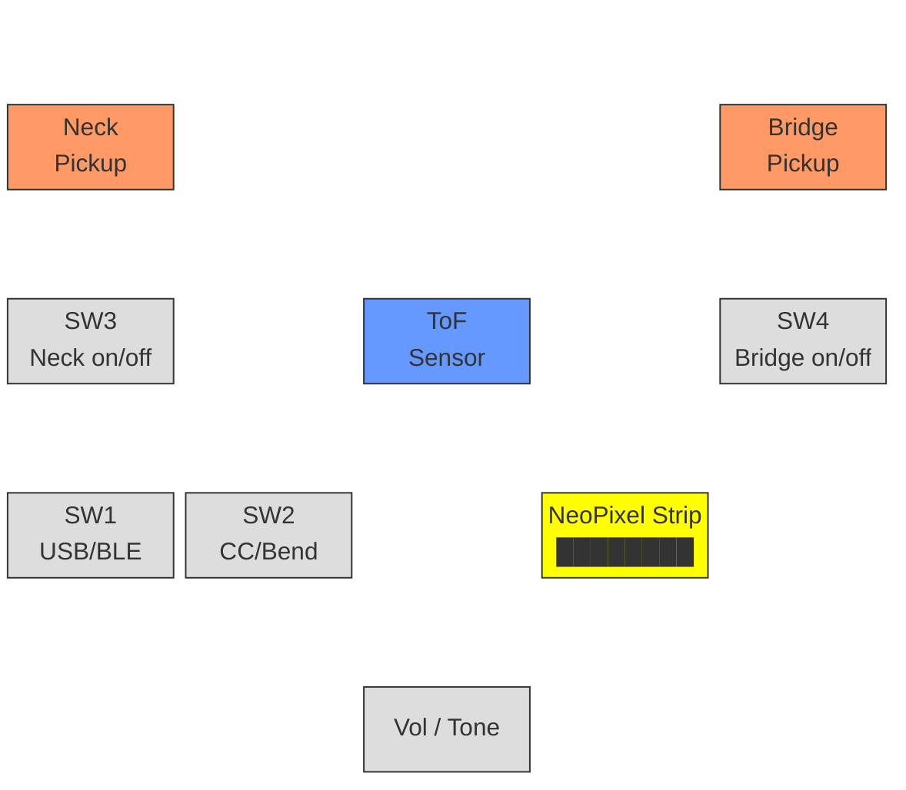

# MIDI Guitar

A time-of-flight distance sensor embedded in a Squier Mustang electric guitar, turning hand gestures into MIDI messages for controlling effects in Max/MSP, Ableton, or any MIDI host.

## How it works

Wave your hand over the VL53L1X sensor mounted near the pickups. The firmware converts distance and hand speed into MIDI CC and pitch bend messages, sent over USB or Bluetooth LE. A slide switch selects the transport; a second switch toggles between CC and pitch bend mode.

## System overview

### Signal flow

```mermaid
graph LR
    subgraph Digital — MIDI control
        Hand([Hand gesture]) --> ToF[VL53L1X\nToF Sensor]
        ToF -->|I2C| ESP[XIAO\nESP32-S3]
        SW1[SW1\nUSB / BLE] -->|GPIO3| ESP
        SW2[SW2\nCC / Bend] -->|GPIO4| ESP
        ESP -->|USB MIDI| Host[Max/MSP\nAbleton\nDAW]
        ESP -.->|BLE MIDI| Host
        ESP -->|GPIO2| Neo[NeoPixel\n8x WS2812B]
        Bat[LiPo\nBattery] -.->|BAT+/-| ESP
    end

    subgraph Analog — guitar audio
        Neck[Neck\nPickup] --> SW3[SW3\non/off]
        Bridge[Bridge\nPickup] --> SW4[SW4\non/off]
        SW3 --> Pots[Vol / Tone]
        SW4 --> Pots
        Pots --> Jack[Output\nJack]
        Jack --> Amp[Amp / Audio\nInterface]
    end

    style Hand fill:#f9f,stroke:#333
    style Host fill:#9f9,stroke:#333
    style Amp fill:#9f9,stroke:#333
    style ESP fill:#69f,stroke:#333,color:#fff
    style Neo fill:#ff0,stroke:#333
```

### Pickguard layout



## MIDI output

| Message    | Source        | Use case                                   |
|------------|---------------|--------------------------------------------|
| CC20       | Hand distance | Continuous modulation (wah, filter, delay)  |
| CC21       | Hand velocity | Speed-based effects (resonance, attack)     |
| Pitch Bend | Hand distance | 14-bit smooth pitch shifting                |

All messages on MIDI channel 1 (configurable). Response curves (linear, log, exponential) shape the distance-to-MIDI mapping.

## Hardware

- **Seeed XIAO ESP32-S3** — microcontroller with USB and BLE 5.0
- **VL53L1X / VL53L4CD** — I2C time-of-flight distance sensor
- **8x WS2812B NeoPixel strip** — color-coded bar graph and status
- **4x SPDT slide switches** (CnK JS102011SCQN):
  - SW1 — USB / BLE transport select
  - SW2 — CC / Pitch Bend mode select
  - SW3 — Neck pickup on/off
  - SW4 — Bridge pickup on/off
- **LiPo battery** — optional, charges via XIAO's built-in circuit
- **3.3V regulator, Schottky diode, passives** — power and protection

## Wiring

### ESP32 connections

| Function      | XIAO Pin | GPIO  |
|---------------|----------|-------|
| I2C SDA       | D4       | GPIO5 |
| I2C SCL       | D5       | GPIO6 |
| NeoPixel DIN  | D1       | GPIO2 |
| Transport SW  | D2       | GPIO3 |
| Mode SW       | D3       | GPIO4 |
| Battery       | BAT+/BAT-| —    |

### Pickup switches (analog audio path)

The neck and bridge pickup switches are standard Mustang-style on/off toggles wired in the guitar's analog signal chain. They are not connected to the ESP32 — they simply connect/disconnect each pickup from the output jack.

## Firmware

Two versions in `code/`:

- **`tof_midi/`** — v1, minimal: distance → CC20 over USB
- **`tof_midi_v2/`** — v2, full-featured:
  - Distance (CC20) + velocity (CC21) + pitch bend
  - USB MIDI or BLE MIDI (slide switch selects)
  - CC / Pitch Bend mode (slide switch selects)
  - NeoPixel bar graph with color-coded feedback
  - Selectable response curves (linear, log, exponential)
  - EMA smoothing with configurable alpha

### Building (Arduino IDE)

1. Board: **XIAO_ESP32S3**
2. USB Mode: **USB-OTG (TinyUSB)**
3. Install libraries: **SparkFun VL53L1X**, **Adafruit NeoPixel**
4. Upload

### Configuration

All tunable parameters are `#define`s at the top of the sketch:

- `MIDI_CH` — MIDI channel (1–16)
- `CC_DIST` / `CC_VEL` — CC numbers for distance and velocity
- `DIST_MIN_MM` / `DIST_MAX_MM` — sensor range mapping
- `EMA_ALPHA` — smoothing factor (0 = heavy, 1 = raw)
- `CURVE` — response curve (`CURVE_LINEAR`, `CURVE_LOG`, `CURVE_EXP`)
- `SWITCH_PIN` / `STRIP_PIN` — set to -1 to disable

## NeoPixel feedback

| State             | Pattern                       |
|-------------------|-------------------------------|
| USB + CC          | Green bar graph               |
| USB + Pitch Bend  | Purple bar graph              |
| BLE + CC          | Blue bar graph                |
| BLE + Pitch Bend  | Cyan bar graph                |
| BLE advertising   | Blue chase animation          |
| Sensor error      | Red flash                     |

Bar graph maps CC value to 1–8 LEDs lit. Brightness capped at ~20% for battery life.

## PCB

KiCad 9 project files in the root directory (`midiguitar.kicad_sch`, `midiguitar.kicad_pcb`). Components are placed; wiring and PCB layout are not yet routed.

Current schematic components:
- XIAO ESP32-S3 module
- 3.3V linear regulator (SOT-223)
- Schottky diode (SOD-123) for reverse polarity protection
- USB-A plug connector
- SPDT slide switch
- 10k resistors and decoupling capacitors

## License

MIT
