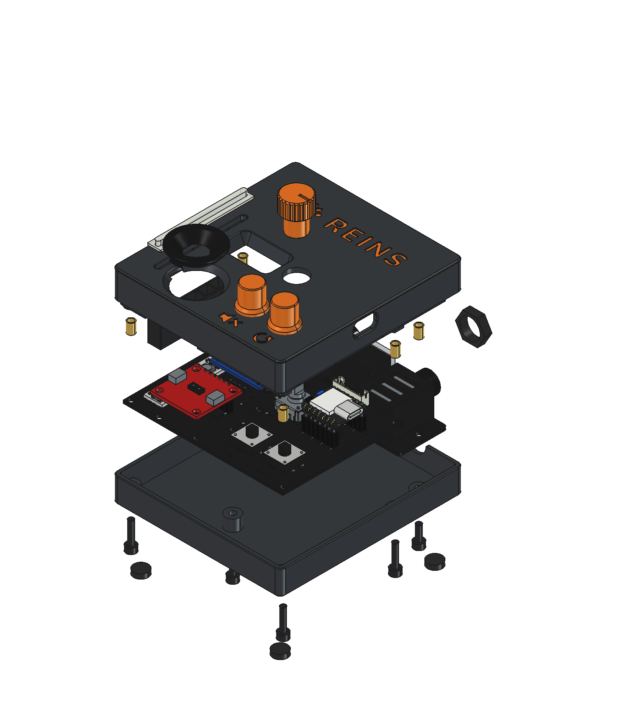

# REINS receiver case

This folder holds the print files of the receiver box case, version 2. The case holds the REINS receiver main board and its jack board. The boards and the FreeCAD script that makes this case are in the separate `heat` repository, which is not public yet. The files here are copies of its `case/v2/stl/` folder.

The case is two printed shells: a tray and a lid, 92.5 x 100.9 x 29.2 mm outside. The lid carries the REINS logo and the MUTE and MODE icons, engraved 0.6 mm deep (plan: `renders/lid-plan-plain.png`). The ToF sensor looks up through a black cone bezel. Eight NeoPixels shine through a light bar. The back wall has three connectors: EXP (expression pedal), MIDI OUT (5-pin DIN) and FOOT (two footswitches on one TRS cable).

## Parts to print

| File in `stl/` | Part | Qty | Filament | On the bed |
| --- | --- | --- | --- | --- |
| `reins-v2-tray.stl` | Tray | 1 | PLA, charcoal | floor |
| `reins-v2-lid.stl` | Lid | 1 | PLA, charcoal | top face |
| `reins-v2-bezel-tof.stl` | ToF bezel | 1 | PLA, matte black | tabs |
| `reins-v2-light-bar.stl` | Light bar | 1 | PLA or PETG, white or natural | flange |
| `reins-v2-light-baffle.stl` | Light baffle | 1 | PLA, black or charcoal | flat |
| `reins-v2-button.stl` | MODE and MUTE caps | 2 | PLA, orange | flat bottom |
| `reins-v2-knob.stl` | Knob | 1 | PLA, orange | top |

The files are already in print orientation. Print settings: 0.15 mm or 0.2 mm layers, 3 perimeters, 15 % infill, no supports, no brim. Use a textured or satin sheet for the lid top.

For orange in the lid engraving, add two filament changes. Change to orange before the layer that ends at Z 0.8 mm. Change back to charcoal before the layer that ends at Z 1.2 mm (0.2 mm layers) or Z 1.1 mm (0.15 mm layers). For a lid in one color, skip the changes. The engraving then shows as a shadow.

## Parts to buy

| Qty | Part |
| --- | --- |
| 5 | M3 x 12 socket head screw (main board) |
| 2 | M3 x 8 socket head screw (jack board) |
| 7 | M3 heat-set insert for a 4.0 mm hole, 5.7 mm long |
| 4 | Rubber bump-on foot, 8 mm, up to 2.5 mm high |
| 1 | JST PH 7-pin cable, 10 to 15 cm, pin 1 to pin 1 |
| 2 | The nuts that come with the Cliff S2 jacks |

## Assemble

1. Press the 7 heat-set inserts into the lid: 5 into the board standoffs and 2 into the jack board columns.
2. Hold the lid upright. Put the bezel into its hole from the top with its tabs at the two notches. Push it down and turn it a quarter turn.
3. Lay the lid face down on a soft cloth.
4. Put the light bar into its slot from inside, flange last. Press the light baffle into the collar after it, until it stops on the flange.
5. Drop the two button caps into their sleeves, top first.
6. Plug the JST cable into the main board J9 and the jack board J4.
7. Lower the main board onto the standoffs, components down.
8. Lower the jack board onto the two columns, components down. The jacks and the DIN socket go into the half holes of the back wall.
9. Lower the tray onto the lid, until the shadow line is even all round.
10. Drive the 5 M3 x 12 screws into the main board holes and the 2 M3 x 8 screws into the jack board holes. Do not over-tighten.
11. Turn the case over. Screw the two nuts onto the jacks.
12. Turn the encoder shaft until its flat faces right, and push the knob on.
13. Stick the 4 feet into the recesses under the tray.

## Back wall connectors

| Connector | Use | Main board pin |
| --- | --- | --- |
| FOOT, 6.35 mm stereo jack | tip = MUTE, ring = HOLD | D1 (MUTE), D7 (HOLD) |
| MIDI OUT, 5-pin DIN | same messages as USB MIDI | D6 |
| EXP, 6.35 mm stereo jack | tip = wiper, ring = supply | D2 |

Use a standard TRS expression pedal. The firmware learns the pedal range after you move the pedal once from heel to toe. It sends CC 11 on MIDI channel 2.

## Not in this folder

These files stay in the `heat` repository: the sliced PrusaSlicer files (`.bgcode`, about 9.5 MB), the FreeCAD model and the STEP files.
