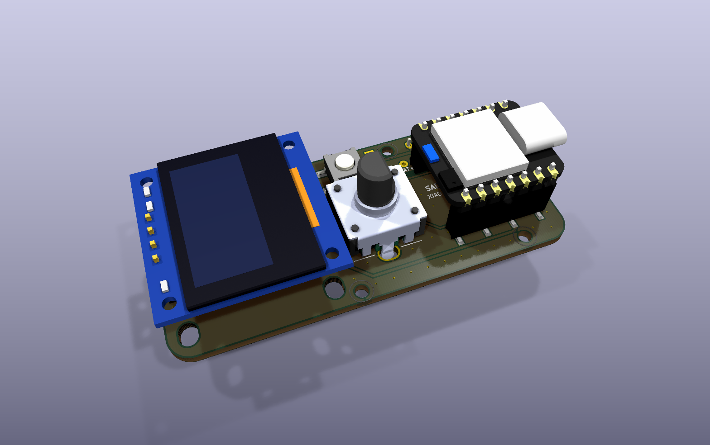
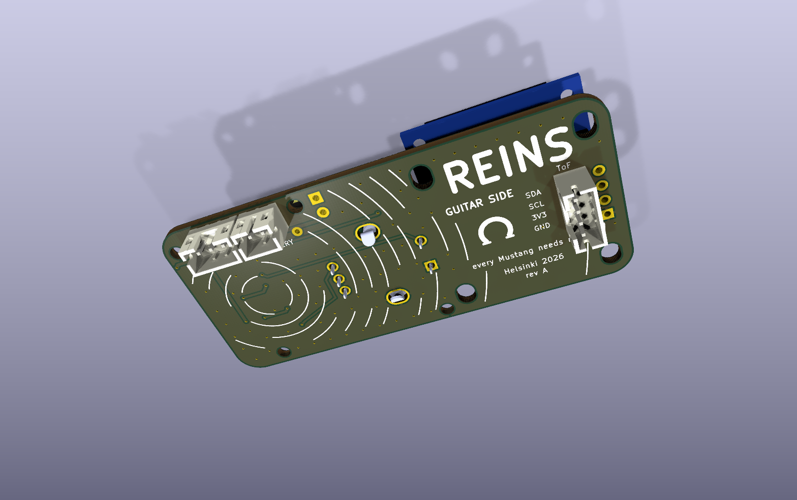

# REINS guitar board for JLCPCB

This is the guitar board of the REINS system, made for JLCPCB. It replaces the milled board in `../finalMidiGuitar/`. These parts stay in the same places, in the same board coordinates: the outline, the four M2 holes, the OLED, the encoder, the button and the USB-C end of the XIAO. The pickguard cutouts and the mounting stay the same.





## What changed from the milled board

1. Two copper layers, a ground pour on both sides and stitching vias.
2. JLCPCB solders the small parts on the top side. The three cable headers stand on the bottom side, so the cables go down into the cavity.
3. A LiPo battery and an on/off switch. D0 reads the battery voltage, and the OLED shows the charge.
4. The LED ring also lights on battery. Two diodes feed it from USB 5 V or from the battery.
5. The button moved from D2 to D1 and uses two diagonal pads. On the milled board, the footprint joined both button pads to one internal contact of the switch. That is why D2 read stuck LOW.
6. The encoder tab slots follow the Bourns PEC12R sheet: 13.2 mm apart, 2.4 x 3.2 mm. The milled board had them 2 mm too close together.
7. The OLED mounting slots are real oval holes, not stacks of round holes.

## Order

Run this command in this folder:

```
/Applications/KiCad/KiCad.app/Contents/Frameworks/Python.framework/Versions/3.9/bin/python3 export_jlc.py
```

It writes `fab/jlc/reins-guitar/` with the Gerber zip, the BOM and the CPL. The steps for the whole REINS order (three boards) are in `heat/kicad/ORDER_JLCPCB.md`.

## Parts that JLCPCB solders

| Parts | LCSC |
| --- | --- |
| U1: SN74LVC1T45DBVR level shifter | C7843 |
| R1: 330 ohm 0603 | C23138 |
| R4, R5: 100k 0603 | C25803 |
| C1, C2, C4, C5: 100 nF 0603 | C14663 |
| C3: 22 uF 25 V 0805 | C45783 |
| D1, D2: B5819W Schottky diode | C8598 |

## Parts that you solder

| Part | Side | Notes |
| --- | --- | --- |
| Two 1x7 female sockets (SMD) for the XIAO | Top | Same sockets as on the milled board |
| OLED module J4 | Top | Pins: GND, VCC, SCL, SDA |
| Encoder S1 (PEC12R-4015F-S0024) | Top | |
| Button SW1 (Omron B3SN) | Top | Any of its four rotations works |
| J1: JST PH 4-pin header B4B-PH-K-S | Bottom | ToF sensor |
| J2: JST PH 2-pin header B2B-PH-K-S | Bottom | Battery |
| J3: JST PH 3-pin header B3B-PH-K-S | Bottom | LED ring |
| Two wires for the on/off switch | J5 pads | For no switch, bridge the two pads with a wire |
| One thin wire from TP1 to BAT+ under the XIAO | TP1 pad | |

Put the headers in from the bottom side and solder them on the top side.

## Cables

| Header | Pin 1 | Pin 2 | Pin 3 | Pin 4 |
| --- | --- | --- | --- | --- |
| J1 ToF sensor | GND | 3V3 | SCL | SDA |
| J2 battery | minus | plus | | |
| J3 LED ring | supply | data in | GND | |

The silkscreen on the bottom side shows the same names next to each header. J1 uses the same pin order as the OLED.

Warning: compare the battery wires with the plus and minus marks before you plug it in. Many LiPo cells come with the wires the other way round. A reversed battery destroys the XIAO.

## Battery and power

1. The battery goes to J2. The switch on J5 is in series with the battery plus wire.
2. Solder a thin wire from TP1 to the BAT+ pad under the XIAO. The XIAO charges the battery over USB-C.
3. The battery charges only while the switch is on.
4. On battery only, the LED ring gets 3.3 to 3.9 V. It dims a little and can flicker near an empty battery. The firmware shows `LOW BAT` at 3.45 V.

## Firmware

`code/tof_midi_v5/tof_midi_v5.ino` reads the button on D1 (mute toggle on every page) and the battery on D0. For the milled board, set `BTN_PIN` and `BAT_PIN` to -1.

## Mechanical notes

1. The holes take M2 screws with heads up to 3.8 mm across. A metal hex standoff on the top side touches the XIAO socket pad next to the top right hole. Use a nylon standoff or a screw head there.
2. The XIAO antenna cable needs to stay outside any metal shielding in the cavity, or the range to the receiver drops.
