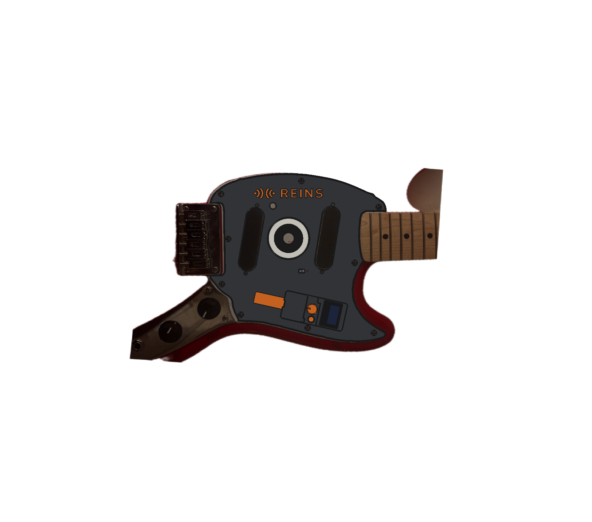
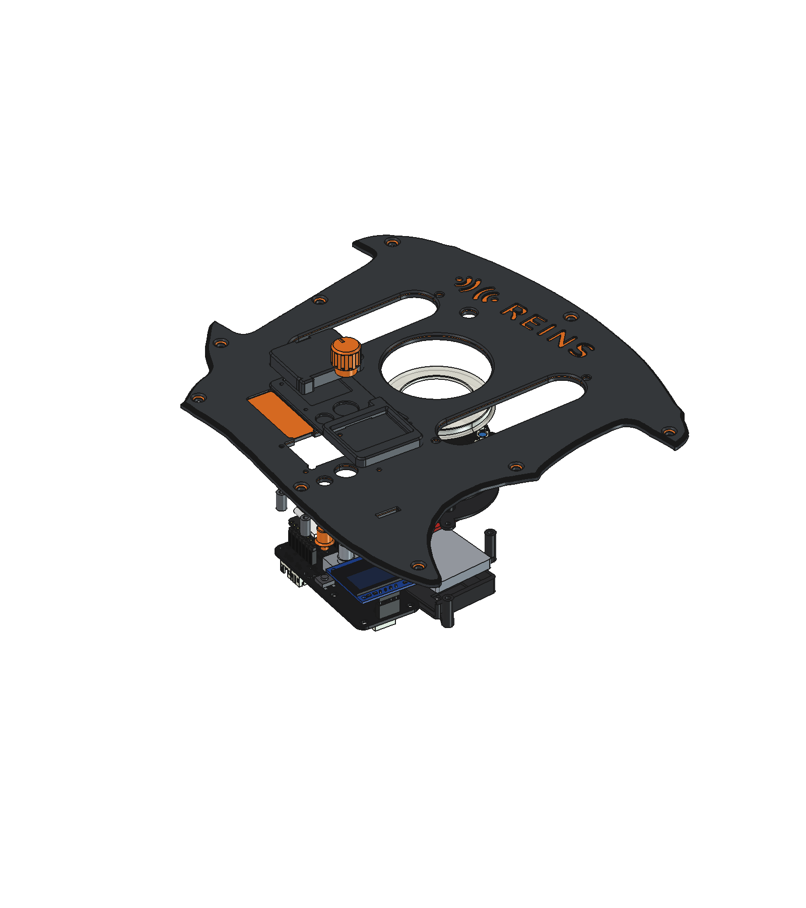
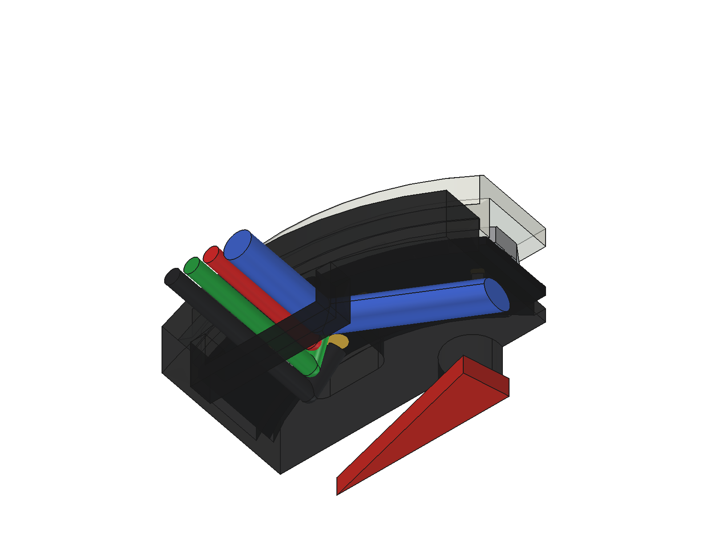
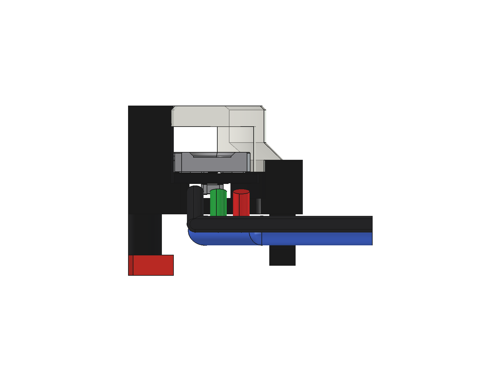

# REINS pickguard

A 3D printed pickguard for a Squier Mustang. The REINS guitar board hangs under it. The ToF sensor looks up through the middle of a 16 LED ring. The OLED, the encoder knob, the mute button and the USB-C port of the XIAO are on top. The battery and its switch are under the plate.

This README describes version 2, the current design (`build_pickguard_v2.py`, folder `v2/`). Version 1 is in [V1.md](V1.md), for reference. A redesign (version 3) is in progress and is not in the repository yet.





More views in `v2/renders/`: `v2-top.png`, `v2-iso.png`, `v2-under.png`, `v2-closeup-controls.png`, `v2-closeup-controls-section.png`, `v2-closeup-pod.png`, `v2-closeup-pod-under.png`, `v2-closeup-pod-section.png` (the yellow cones are the sensor keep-out cones), `v2-closeup-ring-wires.png` and `v2-closeup-ring-wires-section.png` (see "Wiring and cables").

Version 2 has a clean top with no screw heads. One control island sits over the board. The ring glows through a diffuser with an air gap, round a black eye for the ToF sensor.

## Contents

- [Where the sizes come from](#where-the-sizes-come-from)
- [Open points of version 1, solved](#open-points-of-version-1-solved)
- [Logo](#logo)
- [The stack](#the-stack)
- [The parts](#the-parts)
- [Clearances](#clearances)
- [Check before you print](#check-before-you-print)
- [Printing](#printing)
- [Bought parts](#bought-parts)
- [Assemble](#assemble)
- [Wiring and cables](#wiring-and-cables)
- [Make the files again](#make-the-files-again)
- [Files](#files)

## Where the sizes come from

The outline comes from a scan of a Bullet Mustang pickguard, which has the same shape as the Sonic (`ref/forum-scan/`, from squier-talk.com thread 201274). An affine fit (a map that corrects scale and skew) puts the scan on the nine measured screw holes, with a worst error of 1.16 mm. The result is in `ref/scan_outline.json`.

The pickup openings and the two slide switch slots come from the sketch `Sketch001` (Body007) in `cad/cad-midiguitar.FCStd`, copied to `ref/sketch001.json`.

The other positions come from the guitar itself, in `ref/measured.json`. Three photos were made flat with a perspective correction (a homography: a projective map from the photo to millimeters). The correction uses the nine pickguard screw holes:

- `IMG_2407`: the stock pickguard on the guitar, with the pickups.
- `IMG_2408`: the body without the pickguard.
- The "It fits" photo: the milled board in the board cavity.

| Feature | Source | Accuracy |
| --- | --- | --- |
| Outline | The forum scan, fitted to the nine holes | About 1 mm. Test it with the paper template |
| Nine pickguard screw holes | Both photos agree within 0.3 mm. The sketch had them up to 1.9 mm off. | About 0.3 mm |
| Pickup screw holes | The four pickup screws in the photos | About 0.3 mm |
| Pickup openings | Version 1: `Sketch001`, plus 0.1 mm per side. Version 2: the covers measured on the photo | See "Open points of version 1, solved" |
| Board position | The board cavity opening and the milled board in the "It fits" photo | About 1 mm, 1.5 degrees |

The two pickup screws of each pickup are 76.1 and 76.8 mm apart in the photos. The standard spacing is 76.2 mm, so the scale of the photos is right within 1 %.

`cad/cad-midiguitar.FCStd` and the original photos are not in this repository. The scripts read the copies in `ref/` and `v2/ref/`. The forum scan in `ref/forum-scan/` is not in the repository either.

## Open points of version 1, solved

1. **Pickup openings.** The openings now follow the covers. `photo_ref_v2.py` flattens the photo IMG_2407 with the nine screw holes. The two black covers are measured on that picture. Both covers lie at 80.7 and 80.5 degrees. Their screws lie at 80.5 and 80.9 degrees. The sketch openings lie at 78.1 degrees, so the photo agrees with the screws and not with the sketch. A 70 x 18 mm cover, centered between its two screws, matches the photo. The openings are 70.6 x 19.2 mm: 0.3 mm at each end and 0.6 mm at each side. The ends cannot be wider, because the pickup screw holes are only about 1 mm away. The pickup screws have pan heads, so their holes have no countersink.
2. **Slide switch slots.** They are gone. The Squier Sonic Mustang (and the Bullet Mustang HH) has no slide switches. Its pickup selector is a 3-way mini toggle, and that toggle sat in the cavity that now holds the REINS board. The slots of the sketch stood over solid wood. Two vintage slide switches (about 35 mm long each) also do not fit between the pickup ends inside the pickup cavity. Version 2 puts the stock toggle back in a 6.6 mm hole at (64.0, 153.5). That spot is over the pickup cavity, on the bass side between the pickup ends. Its body has 5 mm to the bridge pickup and 8 mm to the pod. Set `TOGGLE=0` for no hole.
3. **Battery switch J5.** An E-Switch EG1201 slide switch hangs under the plate at (96.0, 81.0). It is an SPDT switch with a body of 11.1 x 5.8 x 5.0 mm, a 3 mm actuator and 3 mm travel. That is over the pickup cavity, below the ring and next to the controls. Two M2 x 3 self tapping screws hold its ears. The actuator stands 1.0 mm above the plate in a chamfered slot, so it does not switch by accident. An orange dot marks the ON end: wire it so the slide towards the neck is ON. Run its two wires through the body channel to the J5 pads. Note: the EG1201 is rated 0.2 A (switching). Measure the battery current of your board. If it is higher, use a switch with a higher rating and the same footprint.
4. **OLED angle.** The OLED stays on J4. The board angle (12.5 degrees) comes from the cavity, and the screen turns with the board. A turned screen needs four wires and a second mount, and it adds nothing: the player looks at a tilted guitar anyway. The bezel window is square to the screen.

## Logo

The plate carries logo B, "Two fields": two sensors, each with two rings, face each other like )) ((. The word REINS stands beside them.


1. **Source.** `ref/logo/reins-b-lockup.svg` is a copy of `reins-site/public/logo/reins-b-lockup.svg` (21 Nov, 20:08). The script reads the SVG directly. After a logo change, copy the file again and run the script.
2. **Cut.** The logo goes through the 0.8 mm top ply, so the orange ply shows.
3. **Place.** The logo is in the calm field along the bass side edge, between the two pickups. It is centered on the ring axis (X 81.3, Y 167.5) and runs along the strings. It reads upright for the audience.
4. **Size.** 0.38 mm per SVG unit: 77 x 12 mm, capitals 10 mm. Set `LOGO_S` and `LOGO_Y` to change it. 0.48 is the largest size that keeps 3 mm to every edge and opening.
5. **Line widths.** Measured on a raster at 0.38: the mark strokes are 2.3 mm and the gaps between the rings 1.5 mm. The letter strokes are 1.7 mm and the gaps in and between the letters 1.9 mm or more. All are above the 1.2 mm minimum. Only the sharp inside corners of R and N are narrower. The full lockup meets the limit, so the word stays as it is.
6. **Letters.** The letter outlines in the SVG (Nunito ExtraBold) cross themselves in a few tiny loops, in R and N. The script cuts those loops off, so the letters are clean solids. The shape does not change at print size.

## The stack

All heights are above the body top (the underside of the plate). The plate is 3.0 mm thick.

| Part | Height |
| --- | --- |
| REINS PCB top | -8.10 |
| XIAO underside | 3.00 (the plate top) |
| XIAO USB-C axis | 5.80 |
| OLED module underside | 3.01 (it rests on the plate) |
| Plinth top | 4.20 |
| Bezel top | 7.40 |
| XIAO hood top | 10.30 |
| Knob | 5.20 to 14.20, 12.4 mm across |
| Diffuser | 1.40 to 3.00, flush with the plate |
| Ring LEDs top | -0.60 (2.0 mm air gap to the diffuser) |
| ToF board top | -8.60 |
| Battery cradle bottom | -18.70 |

Three parameters set the stack. Measure the first two before you print.

1. `XIAO_STACK` (default 11.10 mm): from the REINS PCB top to the underside of the XIAO PCB, with the XIAO pushed fully into its two 8.5 mm sockets. The default is the socket height (8.5 mm) plus the header plastic (2.54 mm). The old 9.14 mm came from the KiCad model, which uses 6.6 mm sockets. Measure it on a receiver board with the same sockets. The whole board hangs from this number.
2. `OLED_STACK` (default 11.04 mm): the same for the OLED module on J4 (Harwin M20-7820446, 8.50 mm high).
3. `ENC_SHAFT` (default 15 mm, PEC12R-4215F-S0024): the shaft length of your encoder. The Bourns drawing gives the flat and the collar for each length. The knob bore, the knob hub and the knob height follow from it. With 15 mm, the knob holds 5.9 mm of shaft, and 5.0 mm of that is on the flat. Its hub reaches down into the plate to 1.0 mm above the collar. With 20 mm, the knob holds more and stands higher.

Example: `ENC_SHAFT=20 XIAO_STACK=10.9 FC_EXIT=1 /Applications/FreeCAD.app/Contents/MacOS/FreeCAD build_pickguard_v2.py`.

## The parts

- **Plate.** Three plies as before (1.6 mm charcoal, 0.6 mm orange, 0.8 mm charcoal). The 45 degree edge bevel, the chamfers round the openings, the countersinks, the ON dot and the REINS logo all cut into the orange ply. The orange line and the logo are the only decoration, and they cost two filament changes. See "Logo". The plate has no tall bosses now: only the three short pod bosses (1.2 mm) stand under it, so it prints as a 4.2 mm high flat part. A 0.8 mm groove under the plate lies over the body channel for the wires.
- **BoardSpacers.** Four printed tubes, 4.4 mm across and 8.05 mm long, between the board and the plate. They replace the four 8 mm bosses that grew off the plate with 0.9 mm walls. The board screws go through them.
- **ControlFrame.** One charcoal part on the plate over the board: a 1.2 mm plinth with the OLED bezel at one end. The bezel now reaches round screw H4, which used to end in the 1.2 mm plinth. The frame holds the OLED module down over its two ends with 0.2 to 0.3 mm of clearance. The window starts at the glass and opens 20 degrees to the top, so the whole glass shows and there is no ledge over the glass border.
- **Hood.** A separate charcoal part on the plinth over the XIAO. It prints top down, so it has no ceiling to bridge. The four M2 board screws come from below, through the board, the spacers, the plate and the plinth: H4 into the frame, H1 to H3 into the hood. So the hood, the frame, the plate and the board are one clamped stack, and no screw head shows. The XIAO's FPC antenna can stick on the hood ceiling, above the copper shielded cavity.
- **USB-C.** The hood has a 12.6 x 7.0 mm port with a chamfer. In front of it, a 34 mm lane in the plate goes down into the orange ply, so a normal USB-C cable plugs in flat. You can charge without opening anything.
- **Knob.** Orange, 12.4 mm, 12 flutes 1.8 mm wide (they were 24 at 0.8 mm), a 1.2 mm pointer line over the shaft flat, a D bore with two crush ribs. The hub that reaches down to the shaft has a 1.4 mm wall now (it was 0.7 mm); the knob holes in the plate and plinth are 10 mm across for it.
- **ButtonCap.** Orange. It slides in a 4.2 mm long guide (plate and plinth, 0.2 mm radial clearance). Its flange under the plate is a 45 degree cone now, so it prints top down with no overhang, and the cone meets the plate hole as the stop. The top is flat. It rests on the B3SN plunger with 0.3 mm of free travel up.
- **Pod.** Black, the ring part: the iris, the inner seat rim, three seat spokes, the outer wall and the three ears. It holds the LED ring on the rim and the spokes, with a 1.2 mm groove for the caps and the wire joints. The spokes sit midway between two LEDs, clear of the caps. The ears now go down to the base, so nothing overhangs. The aperture is a cone of 22 degrees half angle from a 2.7 mm circle at the sensor. It stays outside the VL53L1X keep-out cones of the data sheet, also with 0.3 mm of board placement error. The cones are 36.5 degrees (emitter) and 39.6 degrees (receiver), full angles.
- **PodBase.** Black, the base disc under the Pod, with the ear tabs, the two ToF bosses and pads, the light skirt round the sensor, the wire slot and the tie bar (see "Wiring and cables"). The ToF board hangs under it from its two M3 holes. The sensor has 0.3 mm of air above it. Nothing touches it. The three pod screws clamp the PodBase to the Pod.
- **Diffuser.** Natural PETG or white PLA, 1.6 mm thick, flush with the plate. A 2.0 mm air gap above the LEDs spreads the light of the 16 LEDs into an even ring. Its flange under the plate is a 45 degree cone (it was a flat 2 mm ledge). The cone meets the lower edge of the plate hole, so the diffuser stays captive and flush. Its outer skirt holds the ring on its seat with 0.05 mm of clearance.
- **BatteryCradle.** A sleeve for a 36 x 29 x 4.75 mm LiPo (Adafruit 1578 class, 500 mAh, JST PH). It has no ceiling now (that was a 30 x 37 mm bridge). Two lips with 45 degree undersides along the side walls hold the cell edges. Two flexible tongues in the floor, printed flat on the bed, push the cell up with their bumps. A lip at the opening keeps it in. The cradle hangs on the three pod screws. Set `BATTERY=0` for no cradle.

## Clearances

From `v2/checks.txt`.

| Check | Result |
| --- | --- |
| Printed parts touching bought parts or each other | none (only the knob crush ribs, by design) |
| Plastic inside the VL53L1X keep-out cones | 0, also with 0.3 mm placement error |
| Sensor to the pod | 0.31 mm |
| Ring LEDs to the diffuser | 0.40 mm (air gap above the LEDs 2.0 mm) |
| Ring bore to the iris, ring edge to the pod wall | 0.33 mm, 0.65 mm |
| XIAO to the hood, to the plate window | 0.20 mm, 0.43 mm |
| OLED glass to the bezel | 0.25 mm |
| USB-C plug (12.2 x 6.6 mm) to the hood and plate | 0 contact |
| Knob to the frame and hood, to the button cap | 0.50 mm, 1.90 mm |
| Board to the spacers, spacers to the plate | 0.05 mm, 0 (clamped) |
| Button cap guide (radial), up stop | 0.20 mm, 0.30 mm |
| Pickup covers to the openings | 0.30 mm |
| Ring wires to the pod, to each other, to the ring caps | 0.15 mm, 0.23 mm, 1.0 mm (nothing presses on them) |
| Qwiic plug and cable to the pod, to the cradle | 0.14 mm, 2.4 mm |
| Battery switch to the pickups, to the pod | 7.0 mm, 8.7 mm |
| Toggle to the pickups, to the pod | 5.0 mm, 8.3 mm |
| Everything under the plate inside the pickup cavity, 1 mm off its walls | yes |
| Assembly: knob, hood, frame, button cap, board, PodBase, Pod, diffuser and battery come out along their paths | free |

## Check before you print

1. Measure `XIAO_STACK` (and `OLED_STACK`). Then run the script again.
2. The board cavity must be about 24 mm deep. The PCB bottom is 9.7 mm under the body top, the JST headers go 6.1 mm further, and the cables need room to bend.
3. The pickup cavity must be at least 20 mm deep under the ring, for the battery cradle. The photos do not show the depth. If it is less, set `BATTERY=0` and put the battery in the board cavity.
4. The board pose is the same as in version 1. Against the traced cavity: at the USB end and at the far corner on the pickup side, the board corners stand up to 3.5 mm outside the trace. The trace comes from a perspective photo, and the milled board with the same outline did fit. Print the fit test anyway.
5. Print `v2/stl/reins-pg2-fit-test.stl`. It is a 0.6 mm sheet with every opening. Under it hang a hollow board dummy down to the header tips and a depth probe under the pod down to the cradle floor. If both cavities are deep enough and the board fits, the sheet lies flat on the guitar.

## Printing

Every part prints in PLA on the Prusa CORE One with no supports. Each part lies on a flat face, and every face that leans over the void is 45 degrees or steeper, or a short straight bridge. A check of the STL files confirms this. The table lists what is left. The bgcode files in `v2/print/` use the same printer settings as before (0.20 mm SPEED on the CORE One with Generic PLA, 0.15 mm STRUCTURAL on the MINI IS with Prusament PLA, 3 perimeters, 15 % infill). No support is on in any of them. The STL files in `v2/stl/` are already in the print pose.

| File in `v2/stl/` | Part | Filament | On the bed | Left to bridge | CORE One | MINI IS | Weight |
| --- | --- | --- | --- | --- | --- | --- | --- |
| `reins-pg2-plate.stl` | Plate | charcoal, orange, charcoal | top face down | the USB lane roof (13 mm), the logo grooves (2 mm), both bridged by the orange ply | 1 h 33 min | does not fit | 58 g |
| `reins-pg2-board-spacers.stl` | 4 BoardSpacers | any | standing | none | 4 min | 7 min | 0.5 g |
| `reins-pg2-control-frame.stl` | ControlFrame | charcoal | plinth down | two straight 28 mm bridges over the OLED module ends | 7 min | 15 min | 3 g |
| `reins-pg2-hood.stl` | Hood | charcoal | top face down | none | 8 min | 16 min | 3 g |
| `reins-pg2-knob.stl` | Knob | orange | top face down | none | 8 min | 15 min | 1 g |
| `reins-pg2-button-cap.stl` | ButtonCap | orange | top face down | none | 3 min | 5 min | 0.3 g |
| `reins-pg2-pod.stl` | Pod | black, matte | base side down | none | 11 min | 23 min | 5 g |
| `reins-pg2-pod-base.stl` | PodBase | black, matte | base top down | the tie bar (9 mm) | 8 min | 16 min | 3.5 g |
| `reins-pg2-diffuser.stl` | Diffuser | natural PETG or white PLA | top face down | none | 6 min | 12 min | 2.4 g |
| `reins-pg2-battery-cradle.stl` | BatteryCradle | black | floor down | none | 13 min | 24 min | 3.6 g |
| `reins-pg2-fit-test.stl` | fit test | any | sheet down | none | 46 min | does not fit | 23 g |

The plate is 196.8 x 187.6 x 4.2 mm. It fits only the CORE One (250 x 220 mm bed), not the MINI (180 x 180 mm). Lay it with its long side along X, top face down: the file is already in that pose. Use a smooth or satin sheet: the bed side is the visible top. Everything else fits either printer.

The plies, counted from the bed: 0 to 0.8 mm charcoal (the top ply), 0.8 to 1.4 mm orange, 1.4 mm to the end charcoal. The CORE One file has the two filament changes (M600) in it: at the layer that starts at 0.8 mm and at the layer that starts at 1.4 mm. For a multi tool printer, `v2/stl/` also has the three plies as separate files (`reins-pg2-plate-ply1..3`).

The plate keeps the three plies. They are not hard to print: the printer stops twice, at 0.8 mm and 1.4 mm, and you swap the filament. Without them the logo and the edge line lose their orange, and nothing else gets easier. If you want one change only, make the plate two plies: charcoal to 0.8 mm, then orange to the end. The underside and the lower edge of the plate are then orange.

The diffuser times are for PLA. Use the PETG profile for PETG.

What changed for printing, part by part:

1. **Plate.** The four 8 mm board bosses (4 mm across with a 2.2 mm hole, so 0.9 mm walls, 8 mm tall) are gone. Four separate spacers take their place. The plate is now a flat 4.2 mm print with only the three 1.2 mm pod bosses on it.
2. **ControlFrame and Hood.** The hood is its own part, printed top down: its ceiling is on the bed, and the USB port is a slot open at the bottom. Before, the hood ceiling was a 21 mm bridge. The window over the OLED glass starts at the glass, so the ring shaped ledge over the glass border (280 mm2 of overhang) is gone. What is left are two straight bridges over the module ends.
3. **Knob.** 12 flutes 1.8 mm wide instead of 24 at 0.84 mm. The hub wall is 1.44 mm instead of 0.74 mm. The pointer line is 1.2 mm wide.
4. **ButtonCap.** The flange is a 45 degree cone instead of a flat 0.9 mm ledge, the top is flat instead of a shallow dish, and the foot is 3.2 mm across instead of 2.8 mm.
5. **Pod.** It needed supports under the outer wall and the ears. It is now two parts. The Pod prints base side down, with the ears down to the base. The PodBase prints base top down. Neither needs support.
6. **Diffuser.** The flange is a 45 degree cone instead of a flat 2 mm ledge.
7. **BatteryCradle.** The ceiling (a 30 x 37 mm bridge) is gone. Two 45 degree lips hold the cell. The two tongues were 0.6 mm thick plates 0.6 mm above the bed, hanging from one end. They now lie on the bed.

## Bought parts

| Qty | Part | Use |
| --- | --- | --- |
| 4 | M2 x 16 self tapping screw (pan head, 3.8 mm head or less) | board, through the spacers, the plate and the plinth, into the ControlFrame (H4) and the Hood (H1 to H3) |
| 3 | M2 x 18 self tapping screw | battery cradle, PodBase and Pod to the plate (M2 x 6 without the cradle) |
| 2 | M3 x 4 self tapping screw | ToF board to the PodBase |
| 2 | M2 x 3 self tapping screw | EG1201 switch to the plate (a longer screw comes out of the plate top) |
| 1 | E-Switch EG1201 slide switch | battery on/off on J5 |
| 1 | 1S LiPo 36 x 29 x 4.75 mm with JST PH 2.0 (Adafruit 1578 class) | battery on J2 (check the polarity) |
| 1 | Bourns PEC12R-4215F-S0024, or your own shorter encoder (set `ENC_SHAFT`) | S1 |
| 1 | stock Squier 3-way mini toggle and its nut | pickup selector |
| 1 set | cables, see "Wiring and cables" and `../../order/CABLES.md` | J1, J2, J3, J5 |
| 1 | 2.5 mm cable tie or waxed thread | ring wires to the pod tie bar |

Instead of the printed spacers you can use four M2 nylon spacers, 8 mm long and 4 mm or less across. The board then sits 0.05 mm higher.

## Assemble

1. Put the OLED module into the ControlFrame pocket, glass down, pins up. Set the Hood on the plinth over the XIAO end and hold it there with one strip of masking tape over the top. Lay both top face down on a soft cloth.
2. Put the button cap into the plate from below (flange last). Lay the plate face down on the frame. The OLED pins come through the slot.
3. Stand the four spacers on the plate over the board screw holes. Plug the XIAO into its sockets. Lower the board onto the spacers, components down. The XIAO goes through the window into the hood, and J4 takes the OLED pins.
4. Drive the four M2 x 16 screws through the board holes, the spacers, the plate and the plinth into the frame and the hood. When the board sits on the spacers, stop. Take the tape off.
5. Solder the J5 wires to the EG1201 and screw the switch to the plate (M2 x 3). At J5, put the wires in from below and keep the joints on the top side flat: the spacer at H1 is 0.3 mm away from pad 1.
6. Solder the three ring wires straight down onto the ring pads. Thread them down through the Pod slot. Press the diffuser into the ring hole from below, flange last. Lay the ring on the Pod seat, LEDs up, wire pads over the slot. Lower the Pod onto the diffuser.
7. Push the Qwiic plug into the neck side socket of the ToF board. Screw the ToF board under the PodBase (2 x M3 x 4), sensor to the middle. Thread the ring wires through the PodBase slot and set the PodBase under the Pod, ear tabs on the ears. Lay the Qwiic cable under the base, beside the ring wires, through the tie bar. Tie the ring wires and the Qwiic cable to the bar.
8. Slide the battery into the cradle, wire out of the open end. Hold the cradle under the PodBase and drive the three M2 x 18 screws through the cradle posts, the PodBase tabs and the Pod ears into the plate.
9. Plug the ToF, ring and battery cables into J1, J3 and J2. Lay the wires in the groove over the body channel.
10. Turn the plate over. Mount the toggle with its nut. Turn the encoder shaft until the flat faces the pointer side, and push the knob on.

## Wiring and cables

The ring pads, the wires, the tie bar and the Qwiic cable, seen from below. Red is 5V, green is D, black is G, blue is the Qwiic cable:



A cut beside the slot. The G wire drops from its pad through the slot and turns outward between the pod base and the tie bar:



### The ring wires in the pod

1. The three pads (G, D, 5) lie in a radial row on the ring back, at radius 17.2, 19.0 and 20.8 mm. They sit over the pod slot (radius 15.5 to 22.9 mm, 6.0 mm wide), which goes through the base. Nothing covers them.
2. Solder the wires before the ring goes on the pod. Then the pads are free on the bench. Solder each wire straight down onto its pad, at a right angle to the ring. The joints sit in the slot, so they touch nothing.
3. Each wire drops 2.4 mm through the slot. Under the base it turns outward. The three wires lie side by side: G nearest the ToF board, then D, then 5.
4. A tie bar under the base, just outside the slot, holds them. It stands on two posts. The passage is 9.2 mm wide and 2.8 mm high. Tie the wires to the bar with a 2.5 mm cable tie or waxed thread. Then a pull on the cable does not reach the pads.
5. Before this change, the slot had no strain relief. A wire that dropped straight down from the G pad touched the front edge of the battery cradle (0.0 mm in the model). With the tie bar, the wires stay 4.3 mm from the cradle.
6. The model uses 26 AWG silicone wire (1.3 mm). The wires are 0.15 mm from the pod and 0.23 mm from each other. They are 1.0 mm from the ring caps, 1.5 mm from the diffuser and 3.9 mm from the plate. No printed part presses on a wire. The ring, the diffuser and the pod do not clamp any wire.

### The ToF cable in the pod

1. The SparkFun board has two Qwiic sockets (JST SH, 1.0 mm), one on each side edge. It also has a row of 0.1 inch holes: GND, 3V3, SDA, SCL, INT, SHUT, on the edge next to the slot.
2. Use the Qwiic socket on the neck side. The plug is 0.6 mm under the pod base. Its cable runs between the ToF board and the pod base. Then it goes through the tie bar beside the ring wires. It is 0.14 mm from the pod and 2.4 mm from the cradle.
3. Do not use the 0.1 inch holes. The battery cradle is 0.8 mm under the ToF board, and the solder tails on the back reach it. Use them only with `BATTERY=0`.
4. Plug the Qwiic cable in before you screw the ToF board to the PodBase.

### From the pod to the board

All cables leave the pickup cavity at the channel mouth (88, 75.5). They follow the body channel under the 0.8 mm plate groove and enter the board cavity at Y 55. Then they run under the board, below the JST headers, to the connectors. J1, J2 and J3 face down, so the PH plugs go in from below. The cables lift off with the pickguard. They need no slack for that.

The four cables fill the 11 mm channel in one layer (about 11 mm of wire side by side). The channel depth is not measured. The cables need about 1.5 mm under the plate, and the groove gives 0.8 mm.

### The cables

Lengths are along the model route, with the channel taken 2 mm deep and the PH plugs 7.5 mm under the board. `../../order/CABLES.md` has the full tables.

| Cable | Board end | Far end | Pin map | Wire | Route | Make it |
| --- | --- | --- | --- | --- | --- | --- |
| (a) ring | J3, PHR-3 + 3 x SPH-002T-P0.5S | soldered to the ring pads | 1 LED_PWR to "5" (red), 2 LED_DIN to "D" (green), 3 GND to "G" (black) | 26 AWG silicone | 89 mm | 110 mm, pad to housing |
| (b) ToF | J1, PHR-4 + 4 x SPH-002T-P0.5S | Qwiic plug in the ToF board | 1 GND black, 2 3V3 red, 3 SCL yellow, 4 SDA blue | the cable's own wire | 137 mm | cut a 200 mm flexible Qwiic cable (SparkFun PRT-17258) at 165 mm |
| (c) battery | J2, the LiPo's own PHR-2 | the cell | 1 GND black, 2 VBAT red | the cell's lead | 91 mm | a lead of 110 mm or more. An 80 mm lead needs a 50 mm extension |
| (d) switch | J5, soldered (wires in from below) | soldered to the EG1201 | pad 1 VBAT to the middle pin, pad 2 VBAT_SW to the pin that is ON towards the neck | 26 AWG silicone | 76 mm | 100 mm |

Notes:

1. A Qwiic cable has SDA on pin 3 and SCL on pin 4. J1 has SCL on pin 3 and SDA on pin 4. So the warning is true. A plain Qwiic cable also does not fit J1 at all, because J1 is JST PH (2.0 mm).
2. The J1 order (GND, 3V3, SCL, SDA) is the same in the board file and in the schematic (DRC parity is clean). The firmware uses D4 SDA and D5 SCL.
3. Check the LiPo polarity with a meter. Red goes to J2 pin 2. If it is wrong, swap the two contacts in the PHR-2.
4. Which edge of the cell has the lead? On 500 mAh cells of this size, the lead usually leaves the 29 mm edge. In the cradle, that edge faces a side wall, not the opening. Check your cell before you print the cradle. If the lead is on a 29 mm edge, the cradle needs a notch in that side wall.

## Make the files again

```
cd midiguitar/reins-guitar/pickguard
/Applications/FreeCAD.app/Contents/Resources/bin/python -I photo_ref_v2.py
FC_EXIT=1 /Applications/FreeCAD.app/Contents/MacOS/FreeCAD build_pickguard_v2.py
```

`photo_ref_v2.py` takes the two photos out of `cad/cad-midiguitar.FCStd`. It flattens them with the nine screw holes. The worst error is 0.9 mm on IMG_2407 and 0.2 mm on IMG_2408. It writes `v2/ref/` and `v2/web/body_outline.json`. `build_pickguard_v2.py` writes everything else in `v2/`: `reins-pickguard-v2.FCStd`, `reins-pickguard-v2-assembly.step`, `stl/` (print orientation), `web/` (in place, see `v2/web/README.md`), `renders/` and `checks.txt`. `freecadcmd` makes everything except the colors and the renders. When the board STEP and GLB files are missing, the script exports them with kicad-cli into `v2/boards/` and `v2/web/boards/`. After a board change, delete them.

## Files

| Path | Content |
| --- | --- |
| `build_pickguard_v2.py` | The version 2 script. All sizes are parameters at the top |
| `photo_ref_v2.py` | Flattens the two guitar photos and writes `v2/ref/` and `v2/web/body_outline.json` |
| `ref/` | Outline, screw holes, pickup openings and the logo SVG |
| `v2/reins-pickguard-v2.FCStd` | The assembly in FreeCAD, with colors |
| `v2/stl/` | Printed parts in print orientation |
| `v2/print/` | Sliced PrusaSlicer files for the CORE One and the MINI IS |
| `v2/web/` | One STL per part in place, for the website (see `v2/web/README.md`) |
| `v2/renders/` | Pictures |
| `v2/checks.txt` | Measured positions, clearances and assembly paths |
| `v2/ref/` | The flattened photos and the measured pickup covers |
| `build_pickguard.py`, `stl/`, `renders/`, `reins-pickguard-flat.dxf`, `reins-pickguard-paper-template.pdf` | Version 1, see [V1.md](V1.md) |

The script also writes `v2/reins-pickguard-v2-assembly.step` and the board STEP files in `v2/boards/`. They are large, so they are not in git. Run the script to make them.
