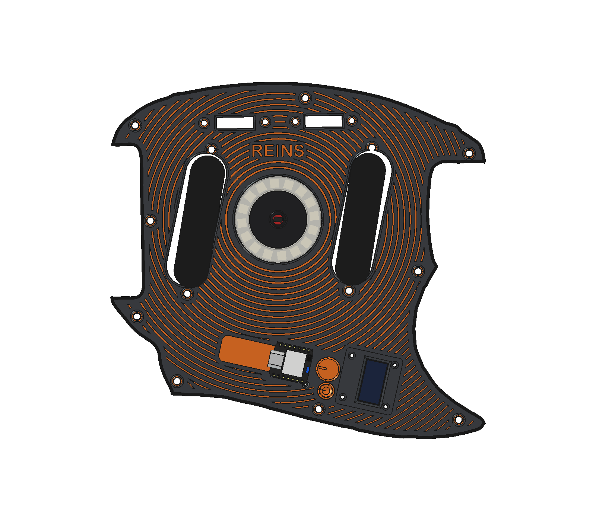
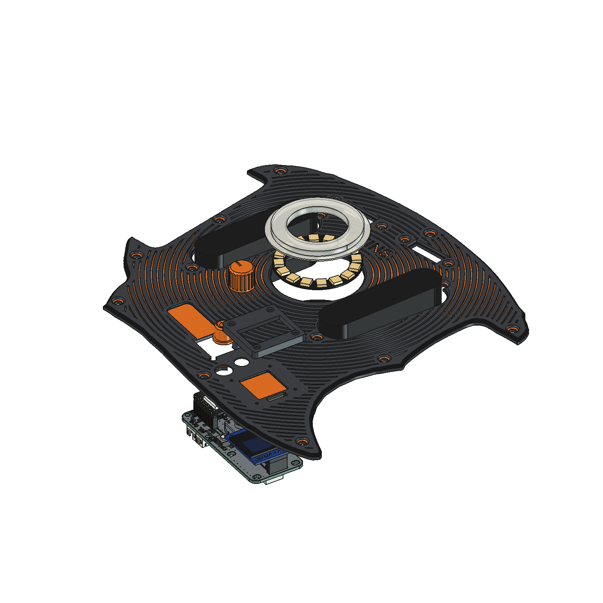

# REINS pickguard, version 1

Version 1 is the first printed pickguard. Version 2 replaces it (see [README.md](README.md)). The files stay in the repository for reference: `build_pickguard.py`, `stl/`, `renders/`, `reins-pickguard-flat.dxf` and `reins-pickguard-paper-template.pdf`. The large assembly STEP is not in git. The script writes it.

Top view:



Exploded view:



The outline, the screw holes and the board position are the same as in version 2. See "Where the sizes come from" in the README.

## Open points

Version 2 solves these points (see "Open points of version 1, solved" in the README).

1. The pickup openings and the pickup screws do not agree. In `Sketch001` the openings stand at 78.1 degrees. The screws in the photos stand at 80.5 and 80.9 degrees, and the cover is parallel to its screws. If the covers sit on the measured screws, they hit the sketch openings by 1.2 to 2.0 mm. One neck pickup screw hole (130.6, 155.1) also breaks 0.44 mm into its opening. Use `reins-pickguard-paper-template.pdf` to find which set matches the guitar.
2. The two slide switch slots stand over solid wood. Their near edges are 5.6 and 6.5 mm outside the pickup cavity. The body has no pocket under them, so a slide switch has no room there. Route two pockets and a wire path in the body, or move the slots.
3. The plate has no hole for the battery on/off switch (J5).
4. The OLED sits on the board, and the board angle comes from the cavity (12.5 degrees). The screen can only turn if it comes off J4 and connects with four wires.

## Build

1. Export the board STEP in the `reins-guitar` folder:

   ```
   /Applications/KiCad/KiCad.app/Contents/MacOS/kicad-cli pcb export step --subst-models --include-tracks --include-pads --include-zones -o /tmp/reins-guitar.step reins-guitar.kicad_pcb
   ```

2. Run the script in the FreeCAD app. Colors and renders need the app, not `freecadcmd`.

   ```
   BOARD_STEP=/tmp/reins-guitar.step FC_EXIT=1 /Applications/FreeCAD.app/Contents/MacOS/FreeCAD build_pickguard.py
   ```

The script puts the part "REINS Pickguard" into `cad/cad-midiguitar.FCStd` and replaces it on each run. The other objects in that file stay as they are. The old milled board model is hidden, because the REINS board now sits in the same place. The first run makes a copy of the file, `cad/cad-midiguitar.pre-reins.FCStd`.

The script also writes `reins-pickguard-assembly.step`, the STL files in `stl/`, the laser cut file `reins-pickguard-flat.dxf` and the renders in `renders/`. All sizes are parameters at the top of `build_pickguard.py`. In the FCStd file, `Pickups_Measured` shows the two pickup covers and `BoardCavity_Measured` shows the traced cavity opening.

## Mounting options

Set `MOUNT` before you run the script, for example `MOUNT=insert BOARD_STEP=... FreeCAD build_pickguard.py`.

| `MOUNT` | Board | ToF eye |
| --- | --- | --- |
| `boss` (default) | Printed bosses under the plate, 4 x M2 x 8 self tapping screws from below | Printed collar, 3 x M2 x 6 self tapping screws |
| `insert` | Printed bosses with M2 heat-set inserts (3.2 mm holes, 4 mm deep), M2 x 8 machine screws from below | As `boss` |
| `standoff` | No bosses. 4 x M2 x 6 female standoffs, M2 countersunk screws from the top | No collar. 3 x M2 x 4 standoffs, M2 countersunk screws from the top |

Use `standoff` for a plate that you do not print. `reins-pickguard-flat.dxf` has every cut that goes through a 3 mm sheet, with 2.4 mm holes for the standoff screws, for a laser cutter.

## Paper test first

Print `reins-pickguard-paper-template.pdf` on A4 at 100 %, with no "fit to page". The bar on the sheet must measure 100 mm. Hold the sheet on the stock pickguard and line up the nine holes. The sheet shows the outline and both sets of pickup positions. To make the file again, run this command in the `midiguitar` folder:

```
/Applications/FreeCAD.app/Contents/Resources/bin/python -I .claude/scripts/pickguard_paper_template.py reins-guitar/pickguard
```

## Fit test

The board cavity is only about 0.5 mm wider than the board. Print `stl/reins-fit-test.stl` before the real pickguard. It is a 0.6 mm sheet with all the screw holes and openings at their real size, and an 8 mm deep hollow dummy of the board under it. It prints in about one hour.

1. Lay it on the guitar and put in two or three pickguard screws.
2. The dummy must drop into the board cavity without force. The pickups must come through their openings.
3. If the dummy hits a cavity wall, measure how far, and set `BOARD_DX`, `BOARD_DY` (mm) or `BOARD_DROT` (degrees) at the top of the script. X points to the neck and Y to the bass side.
4. If a pickup opening is tight, measure the cover with calipers and compare it with the openings in "Open points".

## Jumper wires from the sensors to the board

The ToF board and the ring hang over the pickup cavity. The board is in its own cavity. The body has a channel between the two cavities. The plate has a 0.8 mm deep groove over that channel (`CABLE_GROOVE`), so the jumper wires can lie flat under the plate. The slot in the eye for the ring wires points to the channel.

## Printed parts

| File | Color | Print with this face on the bed |
| --- | --- | --- |
| `reins-pickguard.stl` | Charcoal, orange, charcoal (see below) | Top face |
| `reins-tof-eye.stl` | Black | Top face of the iris |
| `reins-ring-diffuser.stl` | Translucent PETG or natural PLA | Top face |
| `reins-oled-bezel.stl` | Charcoal | Top face |
| `reins-knob.stl` | Orange | Bottom face |
| `reins-button-cap.stl` | Orange | Flange |

The pickguard has three plies of color, like a three ply pickguard. The edge bevel, the countersinks, the chamfers and the engraved rings cut through the top ply and show the orange ply. Print the plate upside down, so that the bosses under it grow upwards and need no support. Then the plies come in this order from the bed:

1. 0.0 to 0.8 mm: charcoal (the top ply).
2. 0.8 to 1.4 mm: orange. Add a filament change at the layer that starts at 0.8 mm.
3. 1.4 mm to the end: charcoal. Add a second filament change at 1.4 mm.

Use 0.2 mm layers. With a multi tool printer, you can use `reins-pickguard-ply1-bottom.stl`, `ply2-middle` and `ply3-top` as three parts on three tools instead.

## Bought parts

| Part | Quantity | Use |
| --- | --- | --- |
| M2 x 8 screw | 4 | REINS board to the four bosses, from below (other `MOUNT` options above) |
| M2 x 6 screw | 7 | OLED bezel (4) and ToF eye to the collar (3) |
| M3 x 8 self tapping screw | 4 | ToF board to the eye (2 on the VL53L1X board) |
| Encoder PEC12R-4225F-S0024 | 1 | S1. Saw the shaft so that its end is 20 mm above the PCB top (`ENC_SHAFT_CUT`) |
| 1 x 4 female header, 2.54 mm | 1 | J4, so that the OLED module plugs in |
| 1 pin male header and 1 Dupont socket | 1 | BAT+ wire from TP1 to the XIAO. The pin does not fit the 0.8 mm TP1 hole, so it goes on the wire end |

The pickguard screws and the pickup screws are the stock ones. The Squier has no slide switches, so you must buy the slide switches and their screws.

## Stack

The plate is 3.0 mm thick and lies on the body. The REINS board hangs 6.1 mm below the plate (`GAP`). With that gap, the XIAO sits on its sockets 0.04 mm above the plate top, and the OLED module rests on the plate. The encoder body sits in a pocket under the plate, and its shaft comes 10.9 mm out of the top for the knob.

The ToF board hangs 8.2 mm below the body top, under the eye. The light path to the sensor is a black cone, so the LED light and the IR light from the sensor do not mix. The ring lies under the diffuser, LEDs up.

## Check before you print

1. Measure the height from the REINS PCB top to the XIAO underside on its sockets. The script expects 9.14 mm. The shop does not list the height of the DS1023-16 strip. If yours differs, set `GAP` to that height minus 3.0 and change `H_SOCKET_TOP`. Do the same for the OLED module (`H_OLED_PCB`).
2. The board cavity must be at least 20 mm deep. The PCB bottom is 7.6 mm under the body top, the JST headers go 6.1 mm further down, and the cables need room to bend.
3. Do the paper test and print the fit test (see above). The photo in the renders is a perspective shot, so it only shows the idea.
4. The outline comes from another guitar of the same shape. A flatbed scan of your stock pickguard at 300 dpi would make it exact.

## Assembly

1. Solder the J5 switch wires from the bottom side. The H1 boss sits 0.2 mm from the J5 pads.
2. Solder a short wire into TP1, and solder the 1 pin header to its other end. Fit a Dupont socket on the BAT+ wire from the XIAO, so the XIAO can come off.
3. Push the diffuser into the ring hole from below. Put the ring in under it, LEDs up, with its wire pads over the slot in the eye. Screw the eye to the collar (3 x M2 x 6).
4. Screw the ToF board to the eye. The sensor goes to the middle.
5. Put the button cap in its hole from below. Then screw the REINS board to the bosses (4 x M2 x 8 from below).
6. Plug the OLED module into J4 through the slot. Put the bezel on and screw it through the module holes into the plate (4 x M2 x 6).
7. Plug the XIAO into its sockets through the window. Put the knob on the sawn encoder shaft.
8. Plug the ToF, ring and battery cables into J1, J3 and J2 under the board.

To take the pickguard off, do these steps the other way round: knob, XIAO, bezel, OLED module, the four board screws. The button cap comes out when the board is off.

## Files

- `build_pickguard.py`: the script.
- `ref/sketch001.json`: the pickup openings and switch slots from the sketch.
- `ref/scan_outline.json`: the outline traced from the forum scan (the scan itself is not in the repository).
- `ref/measured.json`: the screw holes, pickups, cavity and channel measured from the photos.
- `reins-pickguard-paper-template.pdf`: the 1:1 paper test.
- `reins-pickguard-flat.dxf`: the through cuts for a laser cut plate.
- `reins-pickguard-assembly.step`: the assembly with the board.
- `stl/`: the printed parts and the fit test.
- `renders/`: top, iso, underside, exploded and on the guitar.
