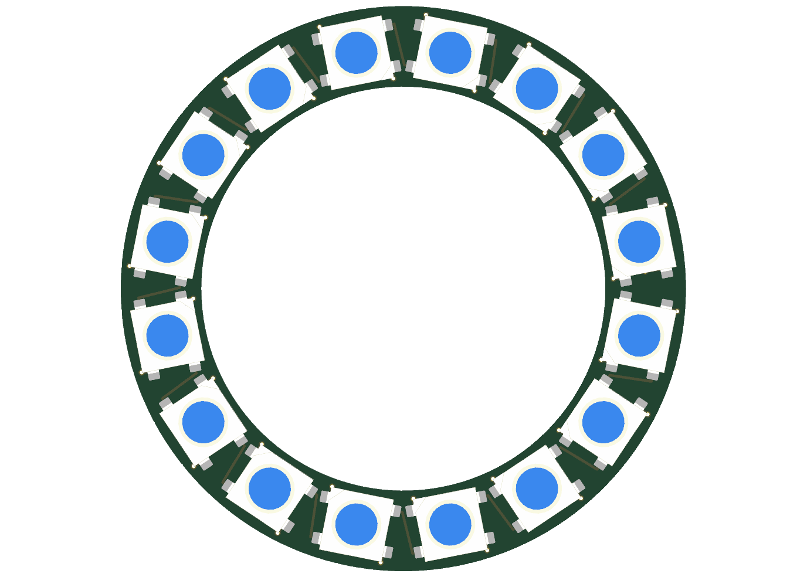
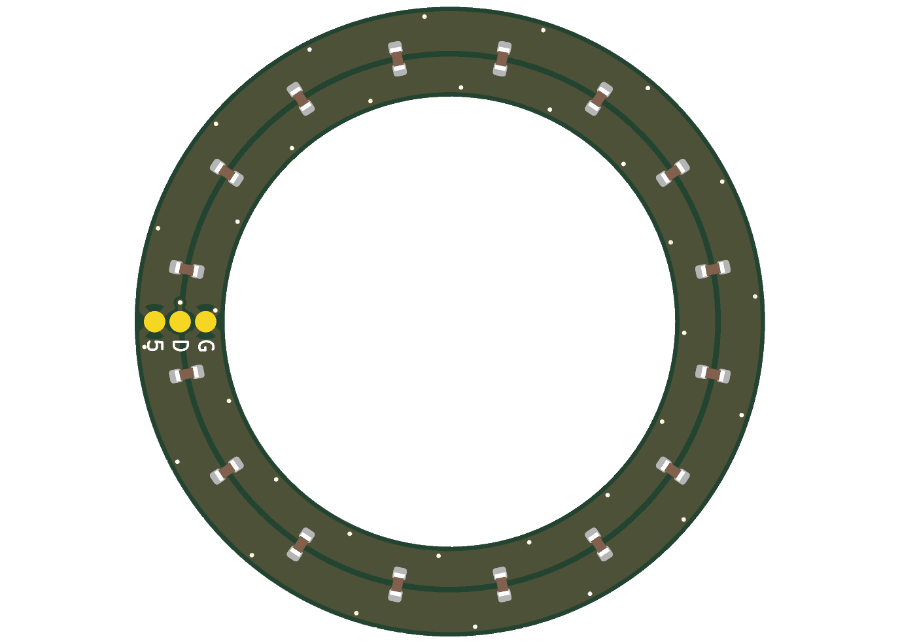

# REINS LED ring (replaces the Adafruit NeoPixel Ring 16)

This is a 2 layer JLCPCB board with 16 WS2812B LEDs (5050) on the top and one 100 nF 0603 cap per LED (LCSC C14663) on the back. JLCPCB solders the 16 LEDs. You solder the 16 caps and three wires to round pads on the flat back face. Nothing hides these pads.

The board file names the LED as LCSC C114586. JLCPCB no longer offers that part, so `export_jlc.py` writes C52917433 (Worldsemi WS2812B-V6, same SMD5050-4P package) into the order files (`SUBST`). Check the pin order in its data sheet before you approve: 1 VDD, 2 DOUT, 3 VSS, 4 DIN.

## Numbers [M]

| Item | Value |
| --- | --- |
| Outline | a plain ring, outer diameter 44.4 mm, bore 31.75 mm (same bore as the Adafruit ring) |
| Board thickness | 0.8 mm. Choose this in the JLCPCB cart. The LED stands about 1.6 mm above the board [D], so board plus LED is 2.4 mm |
| LEDs | 16, center radius 18.9 mm, every 22.5 degrees |
| Caps | on the back, 0603, 0.55 mm high at most [R]. They sit at radius 17.6 to 20.2 mm |
| Wire pads | 3 round SMD pads of 1.5 mm on the back, in a radial row at radius 17.2 (GND), 19.0 (DIN) and 20.8 mm (5V) |

## Wire pads

1. The row sits in the gap between LED16 and LED1. The gap is 2.4 mm wide between the LED bodies. The pads need 1.5 mm. The nearest copper of another net is the notch of the band at 0.2 mm, and the nearest via is 2.5 mm away [M].
2. `PAD_ANGLE` in `make_ring.py` sets where the row sits, as seen from the top. The default is 0, which is +X on the sheet, counter clockwise. The pod turns the ring on its seat, so any angle works. Set it, run the script and export again.
3. The back silk shows one letter beside each pad: G for GND, D for DIN and 5 for 5V. The back view is mirrored.
4. The pads are plain copper. They carry no part and no paste. The 5V and GND pads touch their copper band through spokes, so the iron can heat them.
5. The pad copper reaches radius 16.45 to 21.55 mm. In the pod, the wire slot (radius 16.6 to 22.2 mm) is open under the pads, so no rim touches the solder joints. Turn the ring until the pad gap lines up with the slot.

## Pod interface (back side)

1. Everything on the back that has height is a cap, at most 0.8 mm tall. The caps and the wire joints must fit in the groove of the pod, which is 1.2 mm deep and spans radius 17.4 to 22.4 mm (open at the outer edge). The ring rests on the inner rim and on three outer posts at 90, 210 and 330 degrees in the pod frame.
2. Nothing on the back with height reaches beyond that radius range. The back copper bands are flat and span radius 16.2 to 22.2 mm.
3. The ring turns on its seat to match the pod slot.

## Circuit

1. 5V and GND come in at the pads. The ring has no regulator and no level shifter. The guitar board keeps the level shifter and the 330 ohm resistor.
2. DIN goes through a via beside its pad to LED1. Each LED passes the data to the next one counter clockwise. DOUT of LED16 stays open.
3. The back has two bands: the outer band is 5V and the inner band is GND. Each cap sits across the two bands under its LED. Vias join the LED pads to the bands.
4. For a current budget: 16 LEDs at full white take about 960 mA [R]. The guitar firmware keeps the brightness low by default.

## Files

| File | What it is |
| --- | --- |
| `make_ring.py` | Writes `reins-ring.kicad_pcb` and `reins-ring.kicad_pro`. There is no schematic: this script holds the netlist |
| `drc.sh` | Runs the KiCad DRC on a temp copy with refilled zones |
| `export_jlc.py` | Writes `fab/jlc/reins-ring/` with the Gerber zip, the BOM and the CPL for both sides, and `-top` BOM and CPL files with the 16 LEDs only |
| `renders/` | Top and bottom pictures |

Run the two scripts with the KiCad Python (`/Applications/KiCad/KiCad.app/Contents/Frameworks/Python.framework/Versions/3.9/bin/python3`).

## Order notes

1. Choose Economic PCB Assembly, top side, and upload `reins-ring-top-bom.csv` and `reins-ring-top-cpl.csv`. Economic assembly places one side only, and Standard assembly needs a board of at least 70 x 70 mm. Solder the 16 caps (100 nF 0603) on the back by hand, across the two copper bands. The wire pads are plain copper and need no part.
2. Choose 0.8 mm thickness. The Gerber files do not carry the thickness.
3. Make sure that the pin 1 of each LED matches the placement picture from JLCPCB. Pin 1 (VDD) is the pad on the outer edge, on the counter clockwise side. The DIN pad is on the outer edge, on the clockwise side. Do not approve if one LED differs. The rotation that JLCPCB expects for C52917433 is not confirmed, so `ROT` in `export_jlc.py` is 0 [E]. If every LED is turned the same wrong way, set the correction there and export again.
4. The caps are symmetric parts, so a 180 degree error does not matter.

## DRC [M]

The KiCad DRC on the refilled board shows 0 violations and no unconnected items, with the JLCPCB 2 layer limits (0.15 mm track and clearance, 0.3 mm copper to edge). The courtyard check is off, because the LED courtyards touch in the ring. I did not simulate the board and I did not build one.

## Cost (estimate, not a quote)

I did not get a JLCPCB quote. The LED is about 6 cents each in a cached LCSC listing [R], so 16 LEDs are about 1 euro. The rest is the board, the one time assembly setup fee and shipping. If the LED or C14663 is an Extended part, JLCPCB adds a fee per part type. Put the board in the cart to see the real price. A ring ordered alone is probably not cheaper than the Adafruit ring for one unit. It becomes cheaper in a batch, or when you add it to another JLCPCB order that you already pay for.
